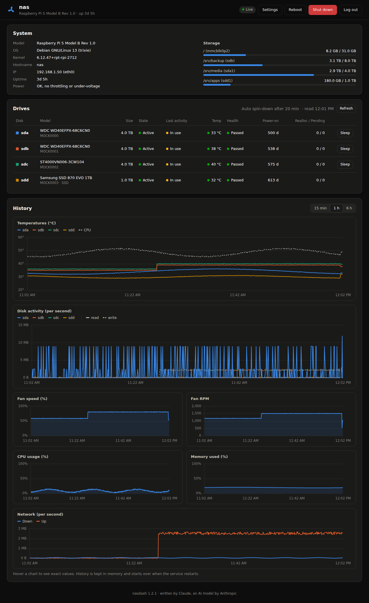
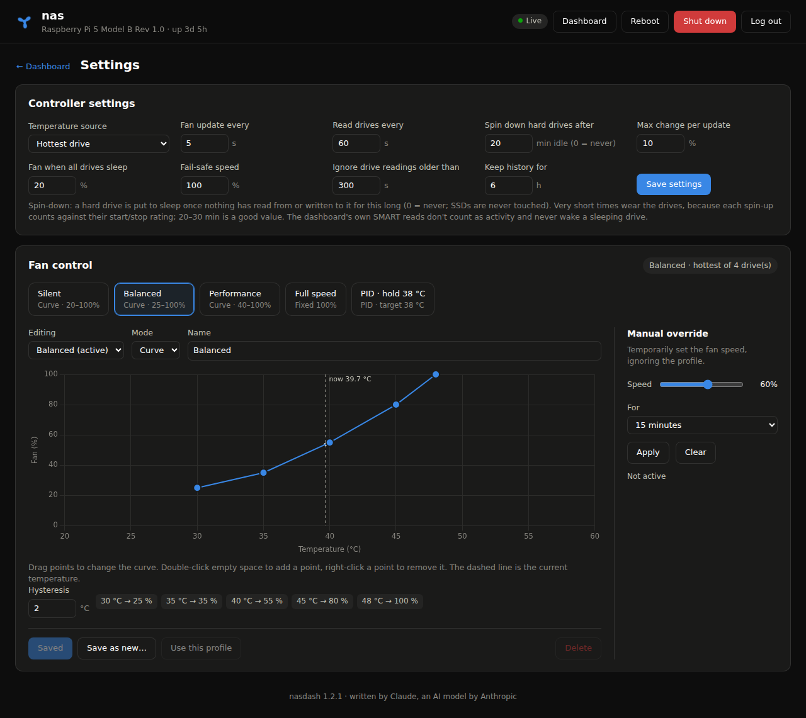

# NAS Dashboard

A web dashboard and fan controller for a Raspberry Pi 5 NAS. It shows the state of the Pi and its drives, controls the case fan through an **EMC2101** based on the drive temperatures, and spins idle hard drives down.

> [!NOTE]
> **This project was written by an AI.** The code, this README and the screenshots were created by **Claude**, an AI model by Anthropic, in a conversation with me ([@sebiiop](https://github.com/sebiiop)). I described what I wanted, ran it on my own Raspberry Pi 5 NAS, and reported the bugs; Claude wrote and fixed the code.
>
> Please read through the code before running it on your own system, especially the installer and the parts that run with `sudo`.



<sub>Screenshots use simulated drives and a simulated fan (mock mode).</sub>

**Built for:**

- Raspberry Pi 5 running Raspberry Pi OS (Bookworm or newer)
- Radxa Penta SATA HAT, or any SATA/NVMe drives that `smartctl` can read
- EMC2101 fan controller on I2C bus 1, address `0x4C` (for example the Adafruit EMC2101 breakout)

## Features

**Dashboard**

- **System:** model, OS, kernel, IP addresses, uptime, power and throttling status, storage usage
- **Drives:** model, size, spun up or asleep, last activity, temperature, SMART health, power-on time, reallocated and pending sectors, and a **Sleep** button to spin a drive down now
- **History charts** over the last 15 minutes, 1 hour or 6 hours:
  - drive and CPU temperatures
  - disk activity: reads and writes per drive
  - fan speed and fan RPM
  - CPU usage, memory and network
- Warnings for failing drives, SMART read errors, a fan that isn't spinning, and fan control errors
- Reboot and Shut down buttons, with a confirmation step

**Settings page**

- **Controller settings:** temperature source, update intervals, drive spin-down timer, ramp speed, idle and fail-safe speeds
- **Fan control:**
  - Profiles: Silent, Balanced, Performance, Full speed, PID, plus your own
  - Curve editor: drag points, double-click to add a point, right-click to remove one
  - PID mode that holds a target temperature
  - Temporary manual override (5 minutes to 4 hours)



**Other**

- Login page with a session cookie, and a Log out button
- Light and dark mode, following your system setting
- Works on phones
- No build step and no internet access needed: plain Python, HTML and JavaScript, with Chart.js included

## Install

1. **Enable I2C** and check that the EMC2101 is detected. It should show up at `4c`:

   ```bash
   sudo raspi-config        # Interface Options → I2C → Enable
   sudo apt install -y i2c-tools git
   i2cdetect -y 1
   ```

2. **Download and run the installer:**

   ```bash
   git clone https://github.com/sebiiop/NAS-RPi_Dashboard.git
   cd NAS-RPi_Dashboard
   sudo ./install.sh
   ```

   The installer:
   - installs `smartmontools`, `hdparm`, `i2c-tools` and the Python packages,
   - creates a `nasdash` system user with I2C access,
   - copies the app to `/opt/nasdash`, with its own Python environment,
   - adds a sudo rule that lets the service **only** read SMART data, spin drives down, and power off or reboot,
   - asks you for a dashboard password,
   - starts the `nasdash` service on port **8080**.

3. **Open `http://<pi-ip>:8080`** and log in as `admin`.

> [!IMPORTANT]
> **Stop any other fan script first.** If another program is also controlling the EMC2101, the two will fight over the fan speed.

### Update

Your settings, profiles and password are kept.

```bash
cd NAS-RPi_Dashboard
git pull
sudo ./install.sh
```

### Uninstall

```bash
sudo systemctl disable --now nasdash
sudo rm -rf /opt/nasdash /etc/nasdash /var/lib/nasdash
sudo rm /etc/systemd/system/nasdash.service /etc/sudoers.d/nasdash /usr/local/bin/nasdash-passwd
sudo userdel nasdash
sudo systemctl daemon-reload
```

## Everyday commands

| What | Command |
|---|---|
| Service status | `systemctl status nasdash` |
| Live log | `journalctl -u nasdash -f` |
| Restart | `sudo systemctl restart nasdash` |
| Change password | `sudo nasdash-passwd` |
| Change the username | `sudo nasdash-passwd --user <name>` |
| Remove the password (not recommended) | `sudo nasdash-passwd --disable` |

A new password takes effect right away and logs out every open session.

## How the fan control works

Every few seconds, the controller:

1. takes the **control temperature**, by default the hottest drive that is spun up,
2. turns it into a fan speed using the active profile,
3. limits how fast the speed can change (10% per update by default), so the fan ramps up and down smoothly.

### Profile types

| Type | What it does |
|---|---|
| **Curve** | Straight lines between your points (temperature → fan %). The curve can only rise. **Hysteresis:** the fan speeds up right away, but only slows down after the temperature has dropped that many degrees, so it doesn't keep going up and down around one temperature. |
| **PID** | Tries to hold a target temperature. **Kp** adds fan % per degree above the target. **Ki** slowly adds more while the temperature stays above the target. **Kd** reacts to how fast the temperature changes. Hard drives heat up and cool down slowly, so keep Ki small and Kd at 0. |
| **Fixed** | Always the same speed. |

For hard drives, a curve with 2 °C of hysteresis is usually the best choice. As a rough guide, drives are comfortable between 30 and 45 °C.

### Drives and spin-down

Linux never spins drives down on its own, and many NAS drives (for example WD Red Plus) ship with their own standby timer switched off. So the dashboard does it: once a **hard drive** has had no reads or writes for *Spin down hard drives after* minutes (20 by default, 0 = never), it's put to sleep with `hdparm -y`. SSDs are never touched. The next time something reads from or writes to the drive, it spins up again by itself (this takes a few seconds).

The dashboard never keeps drives awake itself:

- SMART data is read with `smartctl -n standby`, which **skips sleeping drives instead of waking them**.
- Activity is taken from the kernel's I/O counters (`/proc/diskstats`). SMART queries don't count there, so the dashboard's own reads never make a drive look busy.

Don't set the timer too short. Each spin-up counts against the drive's start/stop rating; 20–30 minutes is a good value.

When every drive is asleep, the fan runs at the *Fan when all drives sleep* speed (20% by default).

### Fail-safe

The fan goes to the fail-safe speed (100% by default) when:

- no drive temperature can be read (drives that are asleep don't count),
- the EMC2101 can't be reached, or anything else in the control loop fails,
- the service stops.

systemd restarts the service automatically if it crashes.

> [!NOTE]
> If the Pi freezes completely, the EMC2101 keeps the fan at the last speed it was given.

## Configuration

Everything you can change on the Settings page is saved in `/etc/nasdash/config.json`. You only need to edit this file for things that aren't on the page:

| Setting | Default | Meaning |
|---|---|---|
| `server.host` | `0.0.0.0` | Address to listen on. `127.0.0.1` allows only local access. |
| `server.port` | `8080` | Web port |

Restart the service after editing the file.

## Try it without the hardware

You can run the dashboard with simulated drives and a simulated fan on any computer with Python 3.10 or newer:

```bash
git clone https://github.com/sebiiop/NAS-RPi_Dashboard.git
cd NAS-RPi_Dashboard
pip install fastapi uvicorn psutil
python -m nasdash --mock --config ./test-config.json --port 8080
```

Then open `http://localhost:8080`. To try the login page as well, set a password first with `python -m nasdash.setpass --config ./test-config.json`.

## Troubleshooting

**The page doesn't load.** Check whether the service is running, and look at the log:

```bash
systemctl status nasdash
journalctl -u nasdash -n 50 --no-pager
```

**The page shows "Fan controller (EMC2101) could not be opened".** Check the wiring, and check that `i2cdetect -y 1` shows `4c`. The rest of the dashboard keeps working in the meantime.

**The fan doesn't change speed, or it hums or whines.**
- 4-pin PC fans expect a PWM signal of about 25 kHz, and the EMC2101 may not be set to that by default. See the PWM frequency settings in the Adafruit EMC2101 library docs.
- A 3-pin fan needs the EMC2101 in DAC mode instead of PWM.

**"no RPM signal" or 0 RPM.** Check that the fan's tach wire is connected to the EMC2101's TACH pin.

**A drive shows "Error".** Run the same command the service uses, to see the real error:

```bash
sudo /usr/sbin/smartctl -n standby,3 -j -i -A -H /dev/sda
```

**A drive never spins down.** Look at the *Last activity* column. If it keeps showing "In use", or the drive wakes up right after you press **Sleep**, some program is reading from or writing to it. To find out which one:

```bash
sudo apt install fatrace
sudo fatrace -t | grep /srv      # replace /srv with where your drives are mounted
```

Common causes: Docker containers or databases stored on the drives, log files, Samba/NFS clients browsing the share, indexers (Plex, Jellyfin, Syncthing), and `ext4lazyinit`, which finishes initialising a freshly formatted ext4 drive in the background and can keep it busy for hours (check with `ps aux | grep ext4lazyinit`). Mounting with `noatime` stops plain reads from causing writes.

**"spin-down failed".** Hover the message for the error, and check that `hdparm` is installed and `/etc/sudoers.d/nasdash` is up to date (run `sudo ./install.sh` again).

**The Reboot or Shut down button fails.** Check that `/etc/sudoers.d/nasdash` exists, and look at the log.

**`FileNotFoundError: '.lgd-nfy…'` in the log.** This came from an older version of the service file, where the service ran from a folder it couldn't write to. Run `sudo ./install.sh` from the current version.

**Forgot the password.** Run `sudo nasdash-passwd` on the Pi.

## Security

- Keep the dashboard on your home network, and **don't forward the port** on your router. For access from outside, use a VPN such as WireGuard or Tailscale.
- Passwords are stored as salted PBKDF2 hashes. A login lasts 12 hours, or 30 days with "Keep me logged in".
- Plain HTTP is fine on your own LAN. For anything else, put the dashboard behind HTTPS, for example with Caddy as a reverse proxy.
- Requests that change something must carry an `X-NasDash` header, and the session cookie is `SameSite=Strict`. Together these stop other websites from triggering actions (like a shutdown) through your browser.
- The service runs as its own `nasdash` user, not as root. Its sudo rule allows only reading SMART data, spinning drives down (`hdparm -y`), and `systemctl poweroff` / `reboot`.

## API

The dashboard uses a small JSON API. Every endpoint except `/api/login` needs a login. Requests that change something also need the header `X-NasDash: 1`.

| Method | Path | Purpose |
|---|---|---|
| `POST` | `/api/login` · `/api/logout` | Start or end a session |
| `GET` | `/api/status` | Current system, drive and fan data |
| `GET` | `/api/history?minutes=60` | Stored samples for the charts |
| `GET` | `/api/config` | Profiles and controller settings |
| `POST` | `/api/profile/active` | Switch profile: `{"key": "silent"}` |
| `PUT` / `DELETE` | `/api/profiles/{key}` | Save or delete a profile |
| `PUT` | `/api/control` | Save controller settings |
| `POST` | `/api/fan/override` | `{"percent": 60, "minutes": 15}`, or `{"percent": null}` to clear |
| `POST` | `/api/drives/refresh` | Read the drives now |
| `POST` | `/api/drives/{name}/standby` | Spin a hard drive down now, e.g. `/api/drives/sda/standby` |
| `POST` | `/api/power/shutdown` · `/api/power/reboot` | Power off or reboot |

## Project layout

```
NAS-RPi_Dashboard/
├── install.sh              installer / updater
├── requirements.txt
├── LICENSE
├── deploy/
│   ├── nasdash.service     systemd unit
│   └── sudoers             allowed sudo commands
├── docs/                   screenshots
└── nasdash/
    ├── app.py              web server, login, API
    ├── control.py          fan curve, hysteresis, PID, spin-down, fail-safe, history
    ├── hardware.py         EMC2101, smartctl, disk I/O, system info (+ mock versions)
    ├── config.py           settings, profiles, password hashing
    ├── setpass.py          password tool (nasdash-passwd)
    └── static/
        ├── index.html      dashboard and settings page
        ├── login.html
        ├── app.js
        ├── style.css
        └── chart.umd.min.js   Chart.js 4
```

## Disclaimer

This project controls your fan and can spin drives down and power off your Pi. Watch the temperatures for a while after installing, and check that the fail-safe behaves as you expect. Use at your own risk.

## Credits

Written by Claude (Anthropic) together with [@sebiiop](https://github.com/sebiiop). See the note at the top.

## License

[MIT](LICENSE).

Includes [Chart.js](https://www.chartjs.org/) (MIT license). Uses the [Adafruit CircuitPython EMC2101](https://github.com/adafruit/Adafruit_CircuitPython_EMC2101) library and Adafruit Blinka (MIT license), [FastAPI](https://fastapi.tiangolo.com/), [Uvicorn](https://www.uvicorn.org/) and [psutil](https://github.com/giampaolo/psutil).
